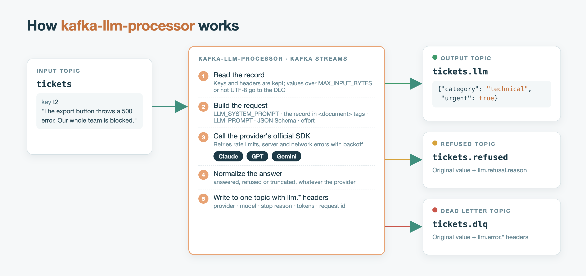
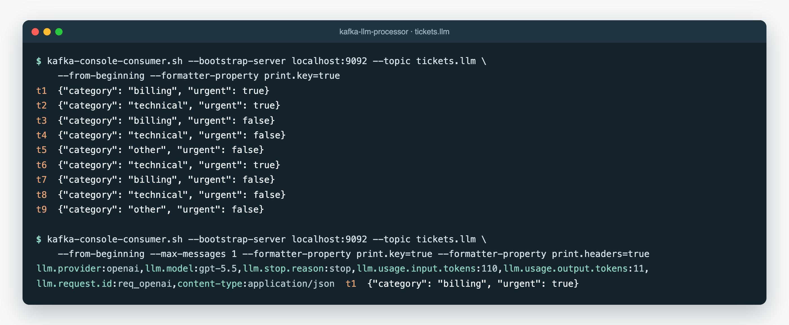

# Kafka LLM Processor

[English](README.md)

Bir topic'teki her mesajı bir büyük dil modeline gönderip cevabı başka bir topic'e yazan bir [Kafka Streams](https://kafka.apache.org/documentation/streams/) uygulaması. **Anthropic Claude**, **OpenAI GPT** ve **Google Gemini** ile çalışır.

Kafka'dan akan metni sınıflandırmak, içinden veri çıkarmak, özetlemek, çevirmek veya normalize etmek için kullanılır. Kod yazmak gerekmez: bir sağlayıcı seçip bir prompt ve isteğe bağlı olarak bir JSON Schema tanımlamanız yeterli.



> Bu bağımsız bir topluluk projesidir. Anthropic, OpenAI, Google veya Apache Software Foundation ile bağlantılı değildir; onlar tarafından desteklenmez ya da onaylanmamıştır.

Apache NiFi için: [nifi-llm-processor](https://github.com/BuseKaylan/nifi-llm-processor).

## Özellikler

- **Tek yapılandırma, üç sağlayıcı:** `LLM_PROVIDER` ve `LLM_MODEL` değerlerini değiştirerek Claude, GPT ve Gemini arasında geçiş yapılır. Her sağlayıcı kendi resmi Java SDK'sıyla kullanılır.
- **Her sağlayıcıda structured outputs:** JSON Schema verilirse cevap, şemaya uyan geçerli bir JSON olur.
- **Üç çıkış topic'i:** Cevaplar output topic'ine, reddedilen istekler refused topic'ine, hatalar ise orijinal mesajla birlikte DLQ'ya gider.
- **Key ve header'lar korunur:** Sağlayıcı, model, token kullanımı ve request id bilgileri `llm.*` header'ları olarak eklenir.
- **Yeniden deneme:** Rate limit, sunucu ve ağ hataları otomatik olarak yeniden denenir. Yine başarısız olursa mesaj DLQ'ya gider ya da uygulama durur; hangisinin olacağını siz seçersiniz.
- **Yavaş çağrılar için güvenli ayarlar:** Saniyeler süren isteklerde consumer'ın gruptan düşmemesi için Kafka ayarları baştan yapılmıştır.
- **Ortam değişkenleriyle ayar:** `KAFKA_` ile başlayan her değişken Kafka Streams'e aktarılır.
- **Stateless:** State store ve RocksDB yok. Ölçeklemek için partition ve instance eklemek yeterli.

## Docker Compose ile hızlı başlangıç

```bash
cp .env.example .env
```

`.env` dosyasında `LLM_PROVIDER` (`anthropic`, `openai` veya `gemini`) ve `LLM_API_KEY` değerlerini, OpenAI ya da Gemini için ayrıca `LLM_MODEL` değerini girin. Sonra her şeyi başlatın:

```bash
docker compose up --build
```

İkinci bir terminalde örnek talepleri gönderin:

```bash
docker compose exec -T kafka /opt/kafka/bin/kafka-console-producer.sh --bootstrap-server localhost:9092 --topic tickets --reader-property parse.key=true --reader-property key.separator='|' < examples/tickets.txt
```

Sonuçları header'larıyla birlikte okuyun:

```bash
docker compose exec kafka /opt/kafka/bin/kafka-console-consumer.sh --bootstrap-server localhost:9092 --topic tickets.llm --from-beginning --formatter-property print.key=true --formatter-property print.headers=true
```



*Örnek taleplerin `tickets.llm` topic'indeki çıktısı. Bu çalıştırmada OpenAI API'sinin yerel bir taklidi kullanıldı; request id bu yüzden temsili.*

## Çalıştırma

**Docker image:**

```bash
docker run --rm -e KAFKA_BOOTSTRAP_SERVERS=broker:9092 -e INPUT_TOPIC=tickets -e LLM_PROVIDER=openai -e LLM_MODEL=gpt-5.5 -e LLM_API_KEY=... -e LLM_PROMPT="Classify this support ticket." ghcr.io/busekaylan/kafka-llm-processor:latest
```

**Jar:** `kafka-llm-processor-<sürüm>.jar` dosyasını [Releases](https://github.com/BuseKaylan/kafka-llm-processor/releases) sayfasından indirip `java -jar` ile çalıştırın.

Input topic'i uygulama başlamadan önce mevcut olmalı.

## Ayarlar

**Zorunlu:** `KAFKA_BOOTSTRAP_SERVERS`, `INPUT_TOPIC`, `LLM_PROVIDER`, `LLM_API_KEY` (ya da sağlayıcının kendi değişkeni: `ANTHROPIC_API_KEY`, `OPENAI_API_KEY`, `GEMINI_API_KEY`), `LLM_PROMPT`. `LLM_MODEL` OpenAI ve Gemini için zorunlu; Anthropic için varsayılan değer `claude-opus-5-5`.

**Topic'ler:** `OUTPUT_TOPIC` (varsayılan `<input>.llm`), `REFUSED_TOPIC` (`<input>.refused`), `DLQ_TOPIC` (`<input>.dlq`)

**Model ayarları:**
- `LLM_SYSTEM_PROMPT`: rol ve kurallar.
- `LLM_OUTPUT_SCHEMA` veya `LLM_OUTPUT_SCHEMA_FILE`: JSON Schema. OpenAI strict modda çalışır; şemada `"additionalProperties": false` olmalı ve tüm alanlar `required` içinde yer almalı.
- `LLM_EFFORT`: `not-set` (varsayılan; modelin kendi varsayılanı kullanılır), `low`, `medium`, `high`, `xhigh`, `max`. Claude'da `effort`, OpenAI'da `reasoning_effort`, Gemini'de `thinkingLevel` ayarına karşılık gelir.
- `LLM_MAX_TOKENS` (varsayılan `16000`), `LLM_BASE_URL`, `LLM_TIMEOUT_SECONDS` (`300`), `LLM_MAX_RETRIES` (`2`).
- `ANTHROPIC_REFUSAL_FALLBACK`: varsayılan `true`, sadece Claude için geçerli.

**İşleme:** `MAX_INPUT_BYTES` (varsayılan 2 MB), `RETRYABLE_ERROR_ACTION` (`dlq` veya `stop`), `KAFKA_*` (diğer tüm Kafka ayarları).

## Header'lar

Output ve refused topic'lerindeki mesajlara şu header'lar eklenir: `llm.provider`, `llm.model`, `llm.stop.reason`, `llm.usage.input.tokens`, `llm.usage.output.tokens`, `llm.request.id`, `llm.refusal.reason`, `content-type`. DLQ mesajları orijinal değeriyle birlikte `llm.error.message`, `llm.error.retryable` ve `llm.error.status` header'larını taşır.

## Teslim garantisi ve ölçekleme

- **At-least-once:** Uygulama çökerse bir mesaj modele iki kez gönderilebilir. `KAFKA_PROCESSING_GUARANTEE=exactly_once_v2` ile Kafka tarafı exactly-once olur.
- **Sıra** her partition içinde korunur.
- **Paralellik:** Partition başına aynı anda bir istek. Hızlandırmak için partition ekleyip `KAFKA_NUM_STREAM_THREADS` değerini artırın ya da daha fazla instance çalıştırın.

## Derleme

```bash
mvn clean verify
```

Testler, her sağlayıcının API formatını taklit eden yerel sahte sunucularla çalışır. Kafka cluster'ı veya API anahtarı gerektirmez, maliyet oluşturmaz.

## Lisans

[Apache License 2.0](LICENSE). Marka ve üçüncü taraf bildirimleri için [NOTICE](NOTICE) dosyasına bakın.
